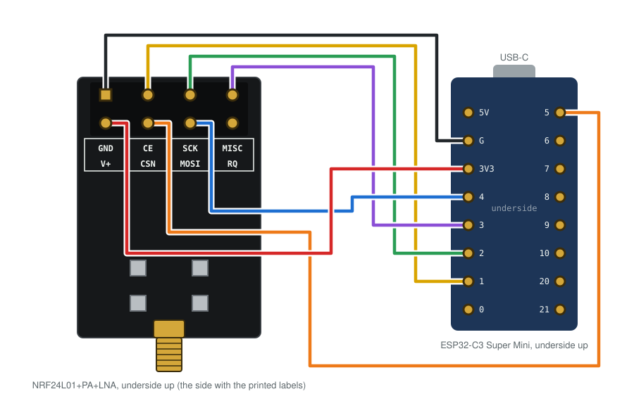

# Quntis Curved RGB Light Bar for ESPHome

Control the **Quntis curved RGB monitor light bar** (the version with the round touch remote that
runs on 3×AA batteries; [Amazon AU B0F4DFJKTQ](https://www.amazon.com.au/dp/B0F4DFJKTQ)) from Home
Assistant, using an ESP32-C3 and an nRF24L01 radio. The ESP32 speaks the remote's 2.4 GHz protocol
directly, so the bar needs no modification.

In Home Assistant you get:

- **Monitor Light**: on/off, stepless brightness and stepless colour temperature
- **Backlight**: Off or any of the 15 RGB modes, by name
- **Auto Brightness**: the bar's light-sensor mode, on/off

### Finer control than the remote

The remote only offers **4 brightness steps and 4 colour temperature steps**. The bar itself accepts
any value from 1 to 255 for both, and Home Assistant uses that full range:

| | Remote | Home Assistant |
|---|---|---|
| Brightness | 4 steps | stepless, 255 levels |
| Lowest brightness | the remote's minimum step | noticeably dimmer: values below the remote's minimum work |
| Colour temperature | 4 steps | stepless across the whole range |
| Changing level | one tap per step | jump straight to any value |

That makes Home Assistant the better way to set brightness, especially for a very dim
night-time setting the remote can't reach. You can still use the remote at any time;
Home Assistant follows it.

## Status

| Feature | State |
|---|---|
| Power, brightness, colour temperature from Home Assistant | working |
| Backlight modes and backlight off | working |
| Auto-brightness on/off | working |
| Brightness below the remote's lowest step | working (the bar is stepless) |
| Home Assistant following the physical remote | working |
| Colour temperature range in Kelvin | uses Quntis's 3000–6500K; a phone meter measured about 4000–6000K |
| Other Quntis models | untested. The older PRO+ uses a different protocol; see [the original project](https://github.com/bluemaex/Quntis-LED-Controller) |

Setting this up with an AI coding agent? Point it at [AGENTS.md](AGENTS.md).

## Hardware

- ESP32-C3 Super Mini
- nRF24L01+ module (the PA+LNA version with an SMA antenna was used here)
- 7 female–female dupont wires
- Recommended: a 10–100 µF capacitor across the radio's V+ and GND

### Wiring



| nRF24L01 | ESP32-C3 |
|---|---|
| GND | G |
| V+ (VCC) | **3V3**, never 5V |
| CE | GPIO1 |
| CSN | GPIO5 |
| SCK | GPIO2 |
| MOSI | GPIO4 |
| MISO | GPIO3 |
| IRQ | not connected |

The PA+LNA module has its labels on the back. The top label row (GND, CE, SCK, MISO) is the pin row
along the board edge, and the square pad is GND. Screw the antenna on before powering it.

## Finding your remote's address

The address and remote ID are probably unique to each remote, so capture your own first.

1. Flash the research firmware: `cd tools/rf-tool && pio run -t upload`
2. Check the channels (optional): send `z` and tap the remote's power button once or twice a
   second for about two minutes. Your remote's channels report dozens of `repeats`.
   ```
   python3 tools/analysis/rfcmd.py /dev/cu.usbmodemXXXX 240 sweep.log z
   grep packets= sweep.log
   ```
3. Capture on one of those channels while tapping a few buttons:
   ```
   python3 tools/analysis/rfcmd.py /dev/cu.usbmodemXXXX 60 capture.log "q 53"
   python3 tools/analysis/decode.py capture.log
   ```
   Each line shows `addr …` and `id …`. Those are the `address` and `remote_id` for your config.

If `decode.py` finds no CRC-valid frames, your model may use a different frame length. Run
`tools/analysis/crcsolve.py capture.log` to find it. [docs/reverse-engineering.md](docs/reverse-engineering.md)
describes the whole method.

## ESPHome setup

Copy [`example-esphome-config.yaml`](example-esphome-config.yaml), set your `address` and
`remote_id`, and keep the `external_components` entry pointing at this repository:

```yaml
external_components:
  - source: github://atr0s/quntis-curved-rgb-esphome
    components: [ quntis_rgb ]
```

To modify the component, copy [`components/quntis_rgb`](components/quntis_rgb) next to your
config and use `type: local` instead.
The backlight mode names in `modes:` are just labels, so rename them to whatever you like.

Notes:

- The ESP listens on one channel when it isn't transmitting, and updates Home Assistant from your
  remote's packets. Each packet carries the full state, so Home Assistant stays in sync.
- The remote keeps its own idea of the state. After a change from Home Assistant, the remote's next
  press is based on what the remote last sent, not on what Home Assistant set.
- State restored at boot is not transmitted, so rebooting the ESP doesn't change the light.

## Protocol

Full details: [docs/protocol.md](docs/protocol.md). In short: XN297 at 1 Mbps on channels 19, 53
and 80, with a 5-byte address and an 11-byte payload that carries the **whole** state in every packet:

```
remote ID (4) | cmd | brightness | colour temp | backlight | mode | counter | checksum
```

## How this differs from the original project

This started from [bluemaex/Quntis-LED-Controller](https://github.com/bluemaex/Quntis-LED-Controller),
which builds on [Lexy1972's reverse engineering](https://github.com/Lexy1972/Reverse-Engineer-a-Quntis-Monitor-LED-Bar-Controller)
of the Quntis PRO+. The hardware and wiring are the same. Everything else is different, because the
curved RGB bar's remote speaks a different protocol on the same kind of chip.

| | Original (PRO+, LI-HY-0208) | This project (curved RGB) |
|---|---|---|
| Remote | rotary puck | touch remote |
| Channels | 2 | 19, 53, 80 |
| Payload | 6 bytes: ID, counter, command | 11 bytes: ID, command, full state, counter, checksum |
| Commands | relative (toggle, step up/down) | absolute state in every packet |
| Brightness / colour temp | stepped from a tracked position | set directly, stepless |
| Calibration | needed, can drift out of sync | none, can't drift |
| RGB backlight | n/a | 15 modes + off |
| Auto-brightness | n/a | on/off |
| Remote → Home Assistant | no (transmit only) | listens and syncs |
| RF24 library | patched fork for XN297 register access | stock RF24; XN297 framing done in software |
| Finding the address | sniffer fixed to channel 2 | channel sweep + capture + CRC solver |

None of the original code is used here. The XN297 scrambling table and CRC are properties of the
protocol.

## Credits

- [Lexy1972](https://github.com/Lexy1972/Reverse-Engineer-a-Quntis-Monitor-LED-Bar-Controller): original
  reverse engineering of the Quntis XN297 link
- [bluemaex](https://github.com/bluemaex/Quntis-LED-Controller): ESPHome component and ESP32-C3 wiring
  this project started from
